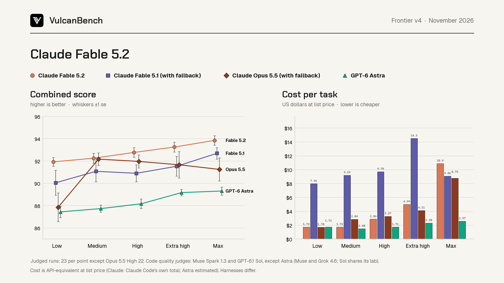
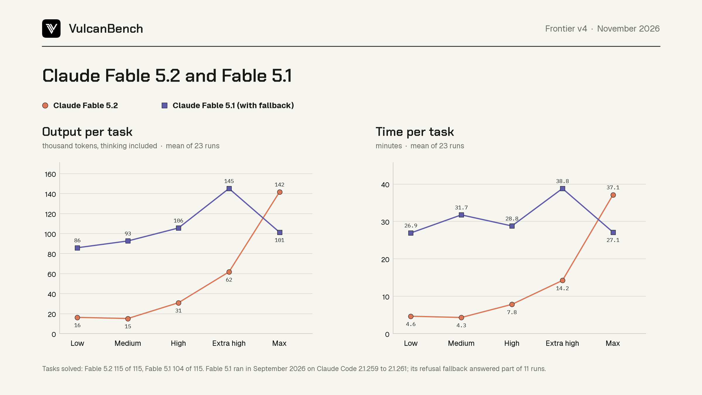
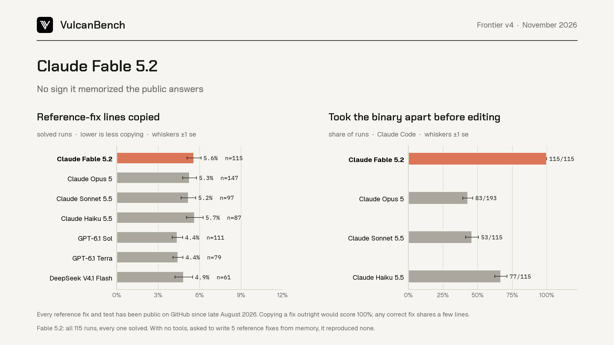

# Claude Fable 5.2 on VulcanBench Frontier v4

Claude Fable 5.2 (`claude-fable-5-2`) in Claude Code 2.1.321, all 23 Frontier
v4 tasks at each of five effort levels, November 9 to 11, 2026. It solved all
115 runs. No earlier Frontier v4 column in this repository solved every run
at every level; GPT-6 Astra came closest, with 114 of 115.



## Results

| Effort | Solved | Combined | Code quality | Minutes per task | Cost per task |
|---|---|---|---|---|---|
| Low | 23 of 23 | 91.92 ± 0.39 | 80.63 | 4.6 | $1.72 |
| Medium | 23 of 23 | 92.25 ± 0.44 | 81.49 | 4.3 | $1.72 |
| High | 23 of 23 | 92.76 ± 0.43 | 82.95 | 7.8 | $2.86 |
| Extra-high | 23 of 23 | 93.25 ± 0.45 | 84.25 | 14.2 | $4.99 |
| Max | 23 of 23 | 93.85 ± 0.42 | 86.02 | 37.1 | $10.88 |

Combined score is 50% functional correctness, 8.5% automated code quality,
8.5% security and 33% judged Code quality (±1 standard error). Code quality is
the mean of Muse Spark 1.3 and GPT-6.1 Sol (see [Judging](#judging)). Cost is
Claude Code's own list-price total per task; the whole sweep came to $509.85
and 26.1 hours.

## Against Fable 5.1, Opus 5.5 and GPT-6 Astra

Best level for each model, from the card's table
([fable52-vs-frontier-efforts.csv](fable52-vs-frontier-efforts.csv)):

| Model | Best level | Combined | Solved, all levels | Cost per task at best |
|---|---|---|---|---|
| Claude Fable 5.2 | Max | 93.85 | 115 of 115 | $10.88 |
| Claude Fable 5.1 | Max | 92.69 | 104 of 115 | $9.06 |
| Claude Opus 5.5 | Medium | 92.16 | 105 of 115 | $2.84 |
| GPT-6 Astra | Max | 89.30 | 114 of 115 | $2.57 |

The three Claude columns share one judge panel, Muse Spark 1.3 and GPT-6.1
Sol (below). Astra keeps its published Muse Spark 1.3 and Grok 4.6 scores,
because Sol, an OpenAI model, cannot judge another OpenAI model.

Fable 5.2 leads at every effort level, though only narrowly at Medium, where
it is 0.08 ahead of Opus 5.5, well inside the standard error of the difference
(0.72). Its Low level (91.92 for $1.72 a task) is above every Astra level and
0.24 below Opus 5.5's best. Fable 5.1 at Max (92.69) stays ahead of it.

### Matched panel: Muse Spark 1.3 and GPT-6.1 Sol

Fable 5.1 and Opus 5.5 were first published from Muse Spark 1.3 and Grok
4.6. Grok failed its exam for Fable 5.2, so Sol took that seat. For the card,
Sol then reviewed the frozen Fable 5.1 and Opus 5.5 patches as well, beside
Muse's existing reviews (rounds v3.30.4 and v3.30.5; see [Judging](#judging)).
The board keeps Fable 5.1's and Opus 5.5's published Muse and Grok scores.
These figures are for this comparison.

Code quality, Muse and Sol:

| Effort | Fable 5.2 | Fable 5.1 | Opus 5.5 |
|---|---|---|---|
| Low | 80.63 | 81.15 | 77.03 |
| Medium | 81.49 | 82.99 | 81.26 |
| High | 82.95 | 83.35 | 80.56 |
| Extra-high | 84.25 | 84.26 | 82.94 |
| Max | 86.02 | 85.01 | 82.87 |

Combined score, Muse and Sol:

| Effort | Fable 5.2 | Fable 5.1 | Opus 5.5 |
|---|---|---|---|
| Low | 91.92 | 90.04 | 87.85 |
| Medium | 92.25 | 91.07 | 92.16 |
| High | 92.76 | 90.89 | 91.96 |
| Extra-high | 93.25 | 91.52 | 91.65 |
| Max | 93.85 | 92.69 | 91.24 |

Sol reviews every model higher than Muse does. The lift is larger for
Fable 5.2 (6.7 to 8.1 points) than for Fable 5.1 (3.1 to 5.5), and is 5.8 to
10.1 for Opus 5.5. Under the matched panel, Fable 5.2's Code quality is within
1.5 points of Fable 5.1's at every level: below it from Low to Extra-high and
1.0 above it at Max. Every gap is inside the standard error of the difference
(1.6 to 2.1).

### Like for like with Astra: Muse Spark 1.3 alone

Muse sat on every one of these rounds, including Astra's, with the same pinned
binary, rubric and weights. Its scores alone are therefore the only like for
like comparison that includes all four models
([muse-like-for-like.csv](muse-like-for-like.csv)):

Code quality, Muse alone:

| Effort | Fable 5.2 | Fable 5.1 | Opus 5.5 | Astra |
|---|---|---|---|---|
| Low | 78.13 | 79.38 | 72.84 | 69.16 |
| Medium | 78.18 | 80.16 | 77.88 | 69.61 |
| High | 79.23 | 80.33 | 77.74 | 71.52 |
| Extra-high | 80.85 | 82.26 | 80.31 | 74.28 |
| Max | 82.80 | 83.51 | 80.15 | 75.28 |

Combined score, Muse alone:

| Effort | Fable 5.2 | Fable 5.1 | Opus 5.5 | Astra |
|---|---|---|---|---|
| Low | 91.09 | 89.46 | 86.47 | 87.05 |
| Medium | 91.16 | 90.14 | 91.05 | 87.20 |
| High | 91.53 | 89.89 | 91.03 | 87.51 |
| Extra-high | 92.13 | 90.86 | 90.79 | 88.77 |
| Max | 92.78 | 92.19 | 90.35 | 88.98 |

Judged by Muse alone, Fable 5.2's code is slightly below Fable 5.1's at every
level, by 0.7 to 2.0 points, each smaller than the standard error of the
difference (1.8 to 2.6 points).
It still leads on combined score at every level, because it solves every
task. Under both panels its lead comes from correctness, speed and cost, not
from code quality.

## How Fable 5.2 works differently from Fable 5.1



Fable 5.1's raw Frontier v4 streams did not survive the September host reset,
and it was not rerun, so the comparison uses what both models left in the
same form: Claude Code's usage receipts, durations and fallback records, and
the patches, which the same evidence builder extracted for both. Fable 5.2's
thinking summaries and tool calls have no Fable 5.1 counterpart, so they
describe Fable 5.2 alone. Per-run data:
[fable52-vs-fable51-runs.csv](fable52-vs-fable51-runs.csv); means by level:
[fable52-vs-fable51-levels.csv](fable52-vs-fable51-levels.csv).

1. **The effort setting now controls how much it thinks.** From Low to Max,
   Fable 5.2's output per task grows 8.7 times (16 thousand to 142 thousand
   tokens) and its time 8 times (4.6 to 37.1 minutes). Fable 5.1's output
   grew only 1.2 times (86 to 101 thousand), peaked at Extra-high (145
   thousand), and its time stayed between 27 and 39 minutes at every level.
2. **It is far leaner at low effort.** At Low, Fable 5.2 used 19% of Fable
   5.1's output tokens, 17% of its time and 22% of its cost, and solved 23
   tasks to Fable 5.1's 19. Over all five levels it cost $510 against $1,159
   and took 26 hours against 59.
3. **More effort goes to thinking, not to writing.** Thinking is 48% of Fable
   5.2's output at Low and Medium, 59% at High and 66 to 67% at Extra-high
   and Max. The patch does not grow: in every one of its 115 runs it changed
   exactly one file, the module under repair, with a median of 97 to 113
   added lines at every level. Fable 5.1's median patch grew from 112 to 190
   lines with effort, it added test files to the repository in 5 to 11 runs
   per level, and a few of its patches ran to thousands of lines (13,978 at
   most). Fable 5.2 kept its test harnesses in scratch space outside the
   workspace.
4. **It was never refused.** Fable 5.1's refusal fallback answered part of 11
   of its 115 runs, and 6 of those 11 failed (6 of its 11 failures had a
   fallback). Fable 5.2 used no fallback in any run, although every run
   disassembled or dumped the legacy binary.
5. **It goes straight to the binary.** Fable 5.2 ran a binary inspection
   tool (otool, nm, strings and similar) in all 115 runs, at a median of the
   second tool call at Low and Medium and the seventh at Max, a median of
   under half a minute into the run. Its first thinking summary at Low typically frames the
   task as black-box reverse engineering; at Max it first surveys the
   repository.
6. **Its checking habits widen with effort.** Every run's thinking mentions
   comparing its rewrite against the legacy binary with generated inputs
   (differential fuzzing). Other themes grow with effort: distrust of the
   written specification (3 runs at Low, 22 at Max), keeping the change
   minimal (4 to 23), forming and testing explicit hypotheses (11 to 23) and
   cleaning up scratch files (2 to 23). These counts come from keyword
   matching over the thinking summaries, a rough measure.
7. **Its editing style shifts with effort.** At Low and Medium it never used
   Claude Code's Edit tool; it edited the module with scripted replacements
   run in the shell. At Max it averaged 8.8 Edit or Write calls per run. The
   share of comment lines in its patches rises from 12% at Low to 19% at
   Max; Fable 5.1's stayed between 9% and 11%.

## Memorization check



Every Frontier v4 reference fix and test has been public on GitHub since late
August 2026, about ten weeks before Fable 5.2, and Fable 5.2 solved every
run, so we checked whether it was reciting answers
([memorization-check.json](memorization-check.json)):

- **Copying.** Its solved patches reproduce 5.6% of the reference fixes'
  distinctive lines verbatim, the same range as six other models (4.4% to
  5.7%), including Claude Opus 5 at 5.3%, which was benchmarked before the
  fixes were public. A recited fix would score near 100%.
- **Working it out.** It inspected the legacy binary before its first edit in
  115 of 115 runs, against 43% to 67% for Opus 5, Sonnet 5.5 and Haiku 5.5.
  An edit here includes a shell command that writes a patched file, since
  Fable 5.2 makes most Low and Medium edits that way.
- **Recall.** With no tools, asked to reproduce five reference fixes from
  memory, it answered each time that it did not remember the fix and wrote
  none. Asked to fix one task blind (quotacore), it declined to write a diff
  and listed only guessed mechanisms. Prompts and verbatim answers are in
  [recall-probe/](recall-probe/).

## Run conditions and disclosures

- **Harness.** Claude Code 2.1.321, pinned (sha256 `abc9feee...f7cd3c`), auto
  updates off: the first release that names Fable 5.2 (2.1.307 served it but
  reported an unknown model and no cost basis). Permission mode auto, safe
  mode, no web access, 3-hour task limit, one task at a time on one machine.
  The integrity audit found no web use and no contamination in any run;
  every write outside the workspace was to scratch space under the temporary
  directory.
- **Thinking summaries recorded.** Runs used `--thinking-display summarized`
  so the traces keep Fable 5.2's thinking summaries (owner decision,
  November 9). Earlier Claude columns recorded none.
- **Refusal fallback** was on, as for every Claude column, and never used.
- **Max waited for the Fable usage limit.** The Fable weekly limit was used
  up by the end of Extra-high. Max started at 23:14 PST on November 10 when it
  reset and finished at 13:28 PST on November 11. The 69 attempts refused by
  the limit did no work and are kept apart, in `infra-aborted/max`.
- **Run summaries undercount two things** (engine fix to follow, grading
  unaffected). The Claude adapter keeps only the last result receipt, and in
  two runs (Low matchcore, Extra-high reflowcore) a background task resumed
  the session after the model stopped, so those summaries count only the
  short tail. It also does not record thinking tokens. Every token figure
  here is summed over all result receipts, from the population records and
  the raw streams.
- **Cost basis.** Claude Code's own list-price total, as for the other
  Claude columns. The adapter's own estimate prices cached prompt tokens at
  the full input price and reads higher (Max $14.01 a task against $10.88).

## Judging

Code quality protocol rounds v3.30 to v3.30.5 (operations
log: [maintenance-v3-operations.md](../../judging/maintenance-v3-operations.md);
decision: [DECISIONS.md](../../DECISIONS.md), November 11):

- v3.30 seated Opus 5.5's panel, Muse Spark 1.3 and Grok 4.6. Grok failed
  calibration gate g14_pair_2_1 (a pair scored 100 one way round and 50 the
  other) and judged nothing; Muse passed every gate.
- v3.30.1: Muse judged Max under its v3.30 verdict.
- v3.30.2 and v3.30.3: on the owner's choice, GPT-6.1 Sol took Grok's seat,
  passed all 20 calibration gates, and judged all five levels on byte-copied
  freezes of the v3.30 and v3.30.1 populations. Twelve Sol answers numbered
  departures from one rather than zero and were published through the
  protocol's frozen rule for that slip, which leaves every score unchanged.
- Published: 115 of 115 runs, both panels passing, no reviewer fallbacks.
- v3.30.4 and v3.30.5, comparison rounds for the card (owner's request,
  November 12): Sol reviewed the frozen Fable 5.1 population of v3.4 (its
  Astra rows dropped, since Sol shares Astra's lab) and the frozen Opus 5.5
  population of v3.15. Sol was gated by its v3.30.2 verdict, with the same
  settings and Codex pins, and Muse's existing reviews were scored beside it.
  All 115 and 114 submissions were published, both panels passing, with no
  reviewer fallbacks. 29 Sol match answers numbered from one and went through
  the same frozen rule. Fable 5.1's solver runs did not survive the September
  host reset, so the frozen-input check rests on the hashes v3.4 recorded.
  Opus 5.5's runs were restored from the private backup and re-read in full.

## Files

| File | What it is |
|---|---|
| `comparison.json`, `comparison-max.json` | Population records the judging froze (Low to Extra-high, Max) |
| `fable52-vs-frontier.png`, `.svg`, `.json`, `-efforts.csv` | Comparison card and its per-level table (`judges` column names each row's panel) |
| `muse-like-for-like.csv`, `.json` | Code quality and combined score from Muse Spark 1.3 alone, four models |
| `fable52-vs-fable51-runs.csv`, `-levels.csv` | Per-run and per-level behaviour measures, both Fable models |
| `fable52-vs-fable51-effort.png`, `.svg` | Output and time per task by effort |
| `memorization-check.json`, `fable52-no-memorization.png` | Memorization check and its card |
| `recall-probe/` | No-tools recall and blind-fix prompts, verbatim answers (`.response`) and receipts |

## Reproduce

The judging directories are in the run worktrees and the private backup
(`judging` archive for v3.4 and v3.15).

```bash
python scripts/cii-v4-board/make_fable52_vs_frontier_card.py \
    --judging runs-code-quality-maintenance-v3.30.2 --judging-max runs-code-quality-maintenance-v3.30.3 \
    --matched-fable51 runs-code-quality-maintenance-v3.30.4 \
    --matched-opus55 runs-code-quality-maintenance-v3.30.5
python scripts/cii-v4-board/fable52_muse_like_for_like.py --v34 <v3.4> --v315 <v3.15> \
    --v3302 runs-code-quality-maintenance-v3.30.2 --v3303 runs-code-quality-maintenance-v3.30.3
python scripts/cii-v4-board/fable52_vs_fable51_behaviour.py --v34 <v3.4> \
    --v330 runs-code-quality-maintenance-v3.30 --v3301 runs-code-quality-maintenance-v3.30.1
python scripts/cii-v4-board/check_fable52_memorization.py
python scripts/export_fable52_redacted_traces.py --out <traces repo> \
    --judging runs-code-quality-maintenance-v3.30.2 --judging-max runs-code-quality-maintenance-v3.30.3
```
